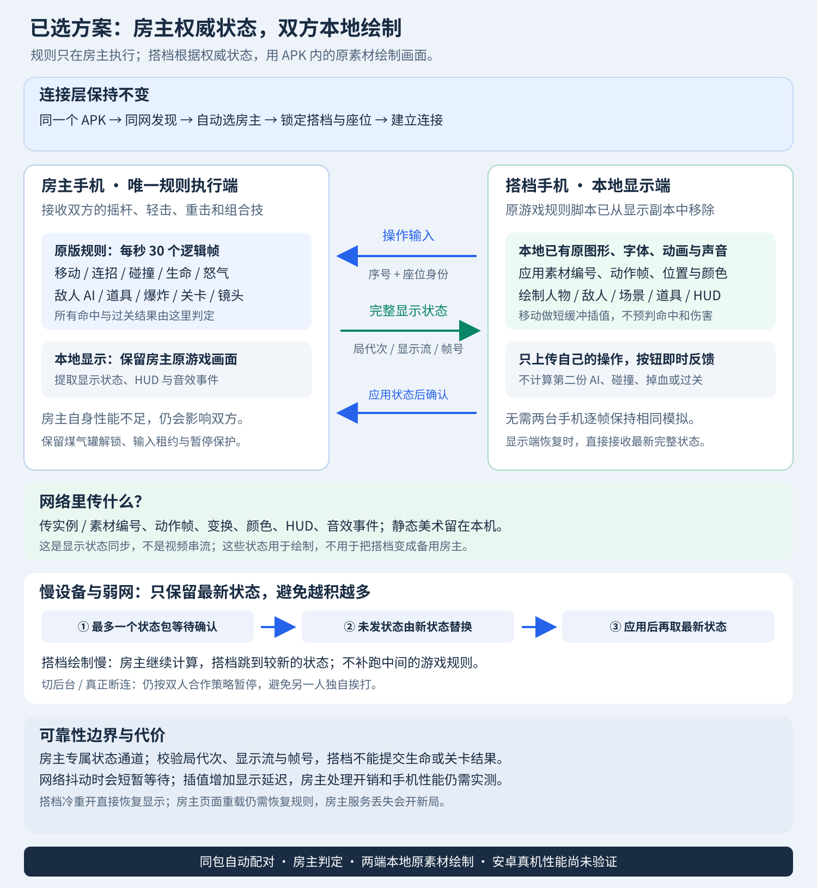

# Dad n' Me · 同包自动双人合作

将《狂扁小朋友》的既有单人运行方式适配为双人局域网合作。当前实现版本 **0.5.0**：两台安卓手机安装同一个 APK，同网自动发现、选主、分配角色；房主计算全部游戏规则，两端用本地素材绘制同一场景。

这是非官方适配工程。原游戏、角色、声音和逻辑的权利归原作者；本仓库开源联机外壳和适配工具，原始及完整改造后的游戏 SWF 不在 Git 中重新分发。见 [素材范围](docs/ASSETS.md) 与 [NOTICE](NOTICE)。

## 已实现

- 一个 APK、自动配对、固定两人座位，阻止第三台抢座。
- 单一房主运行原 AVM1 规则，维持原作 30 Hz 节奏；搭档不运行第二份战斗、碰撞和关卡规则。
- 搭档接收显示状态，在本机绘制角色、敌人、HUD 与音效；不传游戏视频。
- 紫色 P1、青色 P2，独立生命、怒气、攻击与连招状态。
- 八方向多指摇杆、轻击、重击、组合技，保留连续方向触发的冲刺。
- 中文界面、清爽画面、怒气显示与煤气罐/首领登场锁修复。
- 有界显示状态流；慢搭档不阻塞房主；搭档重新打开后恢复当前状态。



## 使用条件和当前验证范围

安卓 8.0 以上，两台设备接入允许互访的同一无线局域网。访客网络、客户端隔离或系统热点限制可能影响发现与连接。选主依据稳定设备标识，当前不保证选中性能更强的手机。

本项目已有桌面 Java 协议、真实本机 UDP/HTTP/WebSocket 与两个独立 Edge 浏览器上下文的验证记录。**安卓真机、真实 Wi-Fi、ARM/WebView 性能、实际触控延迟及完整人工通关仍待验证。** 不把桌面约 30 次/秒的推进样本称为手机实测帧率，也不承诺零延迟。

房主应用/服务结束后创建新局；当前没有无缝房主迁移或持久存档。

## 构建（Windows）

准备 JDK 17、Python 3、Android SDK platform 35 / build-tools 35.0.1，以及外部 FFDec 26.4.0。源码不包含签名密钥。

```powershell
$env:JAVA_HOME = '你的 JDK 17 目录'
$env:ANDROID_SDK_ROOT = '你的 Android SDK 目录'
$env:FFDEC_JAR = '你的 FFDec 26.4.0/ffdec.jar'

python tools/fetch-original.py
pwsh -File swf/build.ps1
pwsh -File app/build.ps1
```

也可以通过 `fetch-original.py --input <本机原文件>` 准备已取得的原文件。脚本会先核对 SHA256，随后 FFDec 在本机导出原脚本，构建完整游戏、独立显示库和桥接。产物为 `app/build/unified/rgm36-duo.apk`，两台安装相同文件。

新环境生成新的测试签名，不能直接覆盖使用其他签名的已安装包。发布自己的正式包时请使用自己的签名，并妥善保管密钥。

## 开发验证

```powershell
pwsh -File app/test/run.ps1
npm install
npm run test:presentation
npm run test:authority
```

前两项不要求安卓设备。双浏览器验收需要 Edge、已构建的游戏资源和 Java 测试类。`test:authority` 检查唯一规则实例、双方输入、本地绘制、慢显示隔离、显示额度、搭档冷重载、房主页面恢复及显示流更新。

煤气罐专项：先运行 `tools/hazards/build.ps1`，再运行 `npm run test:authority-hazards`。历史双端模拟与旧手动房间测试保留供回归参考，不是当前安卓主流程。

## 工程结构

| 路径 | 作用 |
|---|---|
| `app/src` | 安卓宿主、自动发现、配对、房间与协议 |
| `app/assets` | 网页外壳、输入、显示插值、Ruffle 运行时 |
| `swf` | AVM1 双角色、中文/清爽/调色补丁与显示库构建工具 |
| `art/*/runtime` | 构建使用的本地化和清爽显示替换素材 |
| `app/test`、`tools/test-*` | 协议、输入、战斗、恢复与显示回归 |

搭档的显示快照不是完整物理/虚拟机回滚快照。房主规则恢复、搭档画面重建、网络断线和原生服务结束分别处理，详见源码与原理图。

## English

Unofficial two-player LAN co-op adaptation tooling for **Dad n' Me**. One identical Android APK automatically pairs two devices. The host owns the original game simulation; the guest renders authoritative display state using local assets. Original game files are not redistributed or relicensed here. Desktop protocol/browser verification is available; Android device and real-Wi-Fi validation remain pending.

Original shell, adapter tools, documentation and tests: [MIT](LICENSE). Original game, modified game content and third-party dependencies retain their respective rights and licenses.
